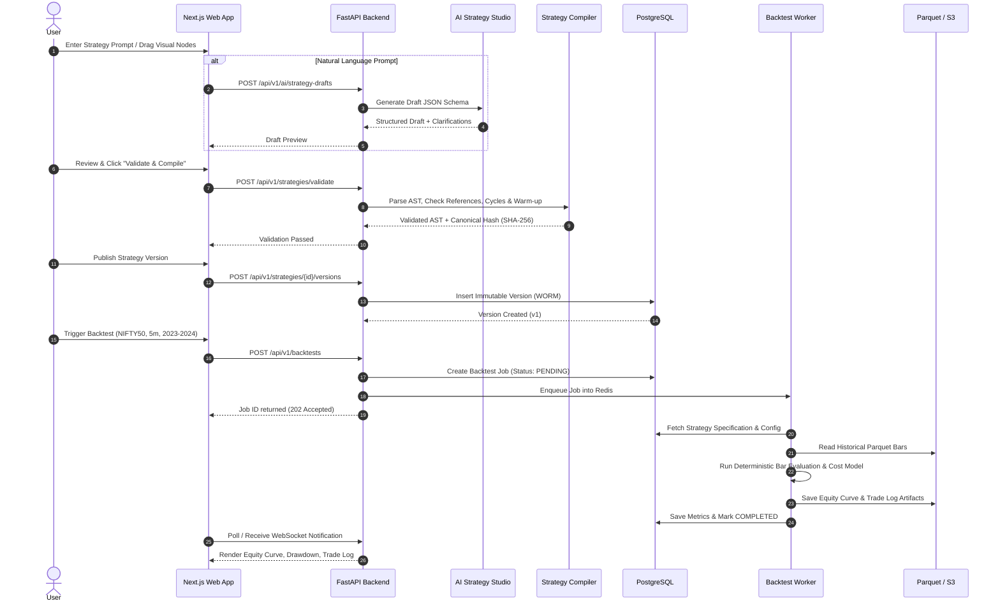

# TradingWave — System Architecture Document
**Version:** 1.0.0  
**Target Market:** India (NSE, BSE)  
**System Topology:** Modular Monolith with Isolated Compute Workers  

---

## 1. Executive Summary & Vision

**TradingWave** is an enterprise-grade algorithmic trading platform designed specifically for the Indian financial markets. It empowers quantitative traders, retail investors, and fund managers to design, validate, backtest, and paper-trade automated strategies across equities, futures, and options.

The system is constructed with absolute separation of concerns between:
1. **Strategy Ideation & AI Drafting** (untrusted, draft generation only)
2. **Deterministic Strategy Compilation & Validation** (strict schema, cycle checks, immutable hashing)
3. **Research & Simulation Engine** (backtesting on licensed historical data, zero look-ahead bias)
4. **Paper Trading Simulation** (real-time replay and virtual order-state machines)
5. **Broker Execution Module** (isolated, dormant, and strictly compliance-gated)

```
+---------------------------------------------------------------------------------------------------+
|                                      PRESENTATION TIER                                            |
|   Next.js 14+ App Router  |  React Flow Visual Builder  |  Lightweight Charts  |  Tailwind CSS     |
+-------------------------------------------------+-------------------------------------------------+
                                                  | HTTPS / WSS
                                                  v
+---------------------------------------------------------------------------------------------------+
|                                      BUSINESS API GATEWAY                                         |
|                          FastAPI (Python 3.12)  |  Pydantic v2 Validation                         |
|      Authentication & RBAC  |  Workspace Scoping  |  Rate Limiting  |  Correlation ID Tracing     |
+-------------------+-----------------------------+------------------------------+------------------+
                    |                             |                              |
                    v                             v                              v
       +-------------------------+   +-------------------------+    +-------------------------+
       |   AI STRATEGY STUDIO    |   |    STRATEGY COMPILER    |    |     WORKSPACE STATE     |
       |  Server-Side LLM Gate   |-->| Canonical AST & Hashing |<-->|  PostgreSQL 16 Storage  |
       | (Draft Generation Only) |   | Immutable Versioning    |    | Multi-tenant Schemas    |
       +-------------------------+   +------------+------------+    +-------------------------+
                                                  |
                                                  v
+---------------------------------------------------------------------------------------------------+
|                                  ASYNC COMPUTE WORKER CLUSTER                                     |
|                                     (Redis-backed Workers)                                        |
|                                                                                                   |
|    +------------------------------------------+    +-----------------------------------------+    |
|    |           BACKTESTING ENGINE             |    |          PAPER TRADING ENGINE           |    |
|    | - Event-driven Bar Evaluation            |    | - Virtual Order State Machine           |    |
|    | - Indian Cost & Slippage Model (STT/GST) |    | - Market Data Replay & Ledger           |    |
|    | - Parquet Historical Ingestion           |    | - Zero Live-Order Permissions           |    |
|    +------------------------------------------+    +-----------------------------------------+    |
+---------------------------------------------------------------------------------------------------+
                                                  |
                                                  v  [STRICT REGULATORY GATE - SEBI / NSE / BSE]
+---------------------------------------------------------------------------------------------------+
|                           FUTURE BROKER EXECUTION PATHWAY (DORMANT)                               |
|   Hard-gated by SEBI Compliance Gatekeeper  |  Broker Capability Adapters  |  Kill Switch Active   |
|               (Features explicitly disabled until statutory approvals are certified)             |
+---------------------------------------------------------------------------------------------------+
```

---

## 2. Core Architectural Principles

1. **Deterministic & Reproducible Logic:**  
   Given the identical strategy specification hash and identical historical dataset version, the backtest engine must produce bit-for-bit identical trade logs, metrics, and equity curves.
2. **AI Sandboxing & Zero Unrestricted Authority:**  
   AI models (LLMs) operate strictly as draft generators. No AI output can directly trigger trades, execute Python code, modify compliance flags, or access broker credentials. Every AI output must pass deterministic compiler validation.
3. **Immutable Strategy Versioning:**  
   Published strategy versions are write-once, read-many (WORM). Any modification produces a new monotonically incremented version number with an independent cryptographic hash (`SHA-256`).
4. **Physical & Logical Execution Isolation:**  
   Backtest compute workers and paper-trading engines have no network or credential access to broker order endpoints. A software defect or crash in a backtest worker cannot leak live orders.
5. **Zero Hardcoded or Fabricated Metrics:**  
   The system never fabricates P&L, Sharpe ratios, or broker connection statuses. Empty states with explicit setup calls-to-action are rendered when real data or credentials do not exist.
6. **Statutory Gating for Indian Markets:**  
   Live retail execution is disabled at the database and application levels until certified compliance artifacts (SEBI Retail Algo circular, exchange empanelment records) are validated by the platform gatekeeper.

---

## 3. Monorepo Structure and Boundaries

```
tradingwave/
├── apps/
│   └── web/                   # Next.js frontend (SPA/SSR, App router, React Flow, Charts)
├── services/
│   ├── api/                   # FastAPI backend (REST API, Auth, Strategy CRUD, Job Dispatch)
│   ├── strategy_engine/       # Compiler, AST canonicalizer, hash generator, validator
│   ├── backtest_worker/       # Event-driven backtesting execution runtime (Parquet, NumPy, Pandas)
│   ├── paper_trading/         # Simulated session runtime, order state machine, position ledger
│   └── broker_adapters/       # Broker connectivity layer (strictly dormant behind feature gates)
├── packages/
│   ├── strategy_spec/         # Shared Pydantic data schemas, conditions, indicator contracts
│   ├── indicator_library/     # Pure mathematical indicator implementations with warm-up rules
│   ├── api_client/            # Typed TypeScript / Python HTTP client
│   └── shared_types/          # Canonical types, error envelopes, correlation context
├── migrations/                # Alembic database migration scripts
├── tests/
│   ├── unit/                  # Fast deterministic tests (indicators, compiler, schemas)
│   ├── integration/           # DB, Redis, and API route integration tests
│   ├── security/              # Tenant boundary tests, token leakage checks, injection prevention
│   ├── backtesting/           # Correctness tests against known bar series & edge cases
│   └── end_to_end/            # System workflow tests
├── infrastructure/
│   ├── docker/                # Production & development container definitions
│   └── deployment/            # Terraform / Kube / Helm / Scripted deployment manifests
├── docs/                      # Architectural specifications, ADRs, compliance runbooks
└── storage/                   # Local storage root for datasets, equity curves, trade logs
```

### Module Boundaries & Invariants:
- **`apps/web`** interacts solely with `services/api` via versioned HTTP/WebSocket APIs (`/api/v1`). It has zero direct access to workers or database pools.
- **`services/strategy_engine`** and **`packages/indicator_library`** are purely stateless libraries with zero database or network dependencies.
- **`services/backtest_worker`** consumes immutable strategy specifications and immutable Parquet dataset partitions from disk/S3. It outputs immutable backtest results.
- **`services/broker_adapters`** is isolated behind `LIVE_TRADING_ENABLED=false` and `SEBI_COMPLIANCE_GATE_ACTIVE=true`.

---

## 4. Data Layer Architecture

### 4.1 Primary Operational Store (PostgreSQL 16)
- **Role:** System of record for users, workspaces, strategy specifications, version records, backtest job metadata, paper session states, and audit trails.
- **Conventions:**
  - Standard UUIDv4 primary keys.
  - Timestamps with timezone (`TIMESTAMPTZ`) stored strictly in UTC.
  - Tenant isolation enforced via foreign keys (`workspace_id`) on all customer-owned resources.
  - Money and pricing stored as `NUMERIC(18, 4)` or `NUMERIC(18, 8)` to prevent floating-point rounding errors.

### 4.2 Analytical & Large Artifact Storage (Parquet / Object Storage)
- **Role:** High-performance storage of tick and minute bar data for Indian equities (NSE EQ) and derivatives (NSE FO).
- **Format:** Apache Parquet with Snappy compression, partitioned by `exchange / segment / year / month / instrument_id`.
- **Large Backtest Outputs:**
  - High-frequency equity curves (tick-by-tick or 1-minute resolution) and extensive trade logs are written as partitioned Parquet or compressed JSON artifacts in object storage, referenced by URI in the PostgreSQL `backtest_results` table.

### 4.3 In-Memory Cache & Message Broker (Redis 7)
- **Role:**
  - Job queues for backtest workers and paper trading session events (`rq` / `celery`).
  - Ephemeral user session caching and rate-limiting buckets (token-bucket algorithm).
  - Pub/Sub for real-time paper session updates streamed to the frontend via WebSockets.

---

## 5. End-to-End Strategy Lifecycle



---

## 6. Indian Market Specifics & Execution Constraints

1. **Market Hours & Sessions:**
   - Pre-market: 09:00 - 09:15 IST
   - Regular Market: 09:15 - 15:30 IST
   - Post-market: 15:40 - 16:00 IST
   - Strategies must account for intraday auto-square-off (MIS orders at ~15:15 IST).
2. **Transaction Cost Structure (Equity & F&O):**
   - Brokerage (flat per trade or % capped)
   - Securities Transaction Tax (STT / CTT)
   - Exchange Transaction Charges (NSE / BSE turnover fees)
   - SEBI Turnover Charges
   - Goods and Services Tax (GST @ 18% on Brokerage + Exchange fees)
   - Stamp Duty (as per state schedule)
   - Backtests without granular statutory cost modeling are fundamentally inaccurate.
3. **Tick Sizes & Price Bands:**
   - Mandatory standard tick sizes (e.g., ₹0.05).
   - Circuit filters (5%, 10%, 20%) and price bands are strictly respected during backtesting fill simulation.

---

## 7. Phased Implementation Roadmap

- **Phase 0:** Repository & Architecture Foundation (Current)
- **Phase 1:** Application Foundation, Identity & Workspace Isolation
- **Phase 2:** Deterministic Strategy Data Model & React Flow Visual Builder
- **Phase 3:** AI Strategy Studio with Structured Schema Validation
- **Phase 4:** Historical Market Data Ingestion & Deterministic Backtesting Engine
- **Phase 5:** Paper-Trading Engine & Event Replay Runtime
- **Phase 6:** Security, Tenant Hardening & Threat Model Remediation
- **Phase 7:** Broker Integration Interface (Sandbox / Dormant live gate)
- **Phase 8:** Pre-Production Compliance & Operational Audit Review
- **Phase 9:** SaaS Subscription, Entitlements & Controlled Strategy Marketplace
